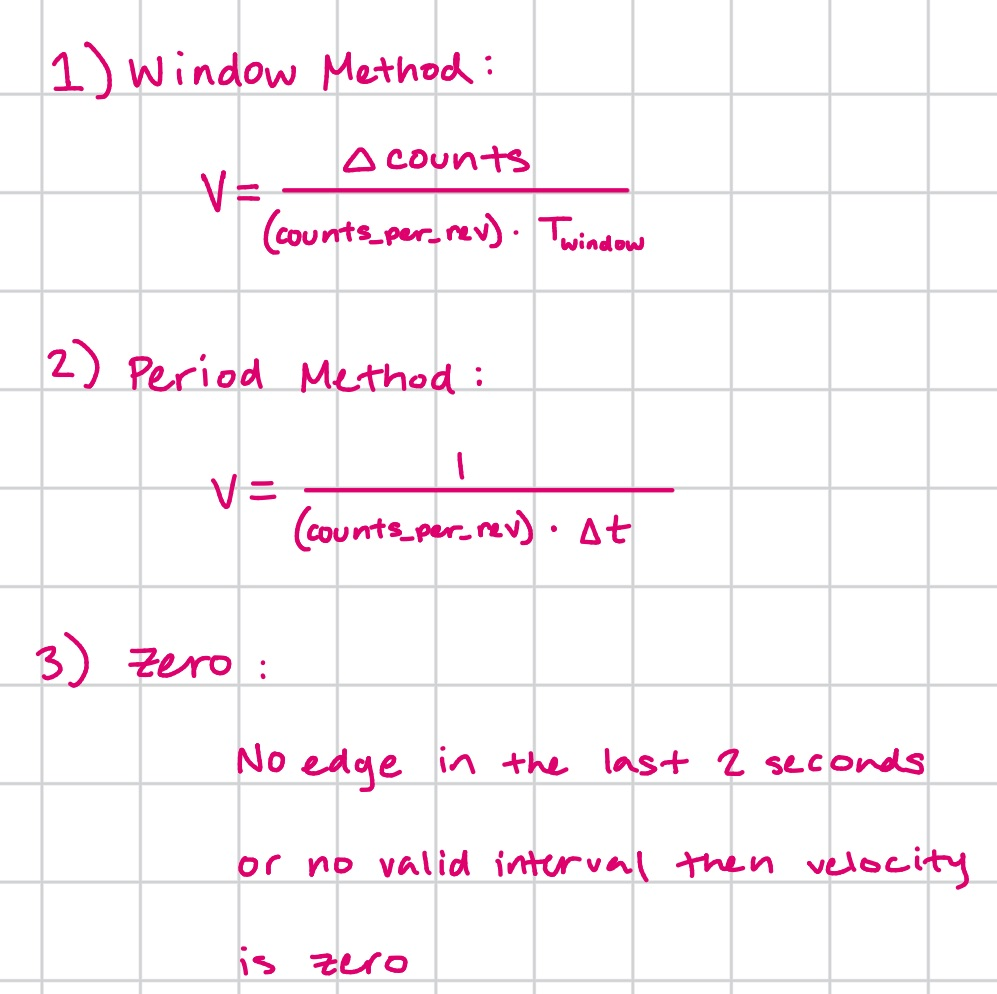
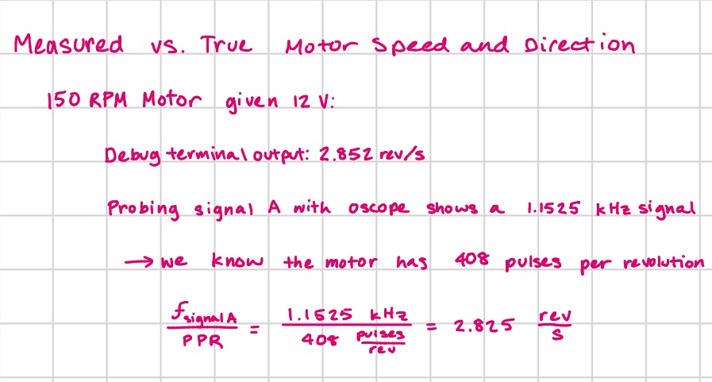
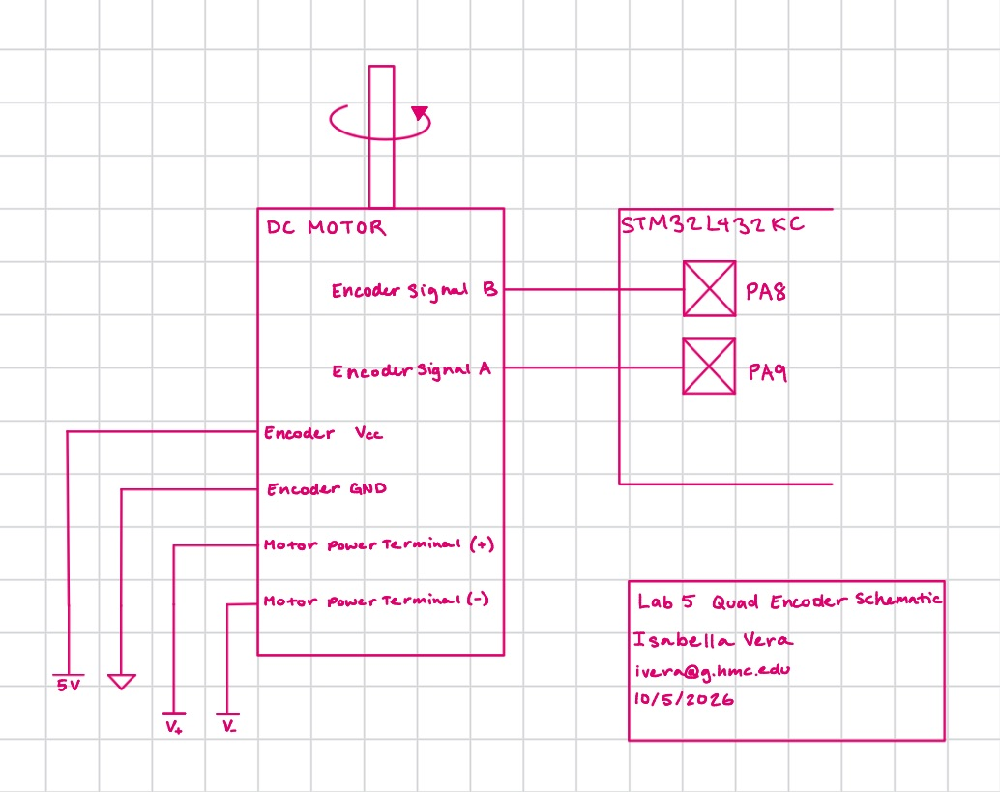
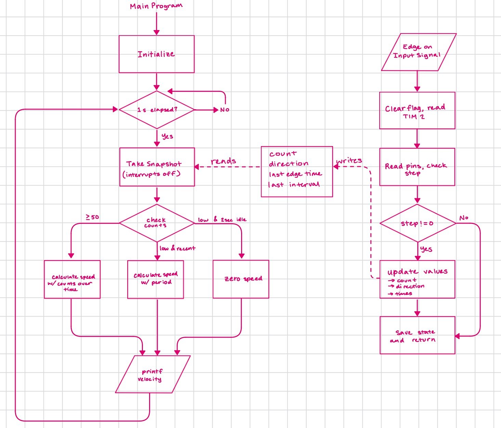

## Introduction
For this lab, I built a system to determine the angular velocity of a brushed DC motor using my MCU, a quadrature encoder, and a motor. I set up the MCU to use interrupts to detect pulses from the encoder and use them to calculate a direction and velocity. I ensured that the system remains functional when the motor is spinning at very high and very low speeds by changing the way I calculate velocity based on the time between encoder pulses. I display the direction and angular velocity of the motor in revolutions/s with an update rate of 1 Hz using printf.

## Technical Documentation
The source code for the project can be found in the associated [Github repository](https://github.com/isabella-vera/E155/tree/main/Lab5)

## Calculations

### Converting encoder pulses to velocity and direction
The encoder has two Hall-effect channels, A and B, 90° out of phase. The Interrupt Service Routine (ISR) triggers on both the rising and falling edges of both channels.

The ISR reads both pins at once and forms a 2-bit state, (A << 1) | B. In one direction the state sequence is 00 → 01 → 11 → 10 → 00, and in the other it runs in reverse. The ISR looks up the (previous state, current state) pair in a 16-entry table where one step forward gives +1,one step backward gives −1, and no change (or a 2-bit jump) gives 0.

The ISR adds the result to a signed count, so the count increases in one direction and decreases in the other. The sign of the velocity comes from the sign of the count change. A positive change is displayed as CW, and a negative change is displayed as CCW (when looking down at the spinning shaft). 

On each valid edge the ISR records a timestamp from TIM2 and the number of ticks since the previous valid edge. The counter wraps only every 2³² µs ≈ 71.6 minutes. This is a pretty long amount of time and why I wanted to use the 32-bit counter.

The main loop takes a snapshot of the count, last-edge time, last interval, and direction, with interrupts briefly disabled while it samples so we don't get any weird values. It then uses one of three methods to calculate the velocity. I implemented this 3 method approach to ensure the reading was accurate across a wide range of motor speeds. The three methods are described below.

#### Window Method
The window method is used for faster speeds (>= 50 counts). T_window is the measured time between snapshots in ticks, not an assumed 1 s, so the result stays correct if the loop runs slightly long. 

#### Period Method
The period method is used for slow speeds. If fewer than 50 counts arrived and an edge occurred within the last 2 s then the velocity is calculated using the last interval between edges. Δt is the larger of the last interval and the time since the last edge. Using the time since the last edge helps get low-speed readings more accurately.

#### Zero Method
The last method just outputs zero velocity. If there is no valid interval yet or no edge in the last 2 seconds, the speed is reported as 0.

### Update Rate and Resolution

The update rate is set by the update period of 1 s, declared at the top of `main.c` as `UPDATE_PERIOD_TICKS`. So the update rate is 1 Hz. The loop stores the time of each update before it calls `printf`, so print time does not lengthen the period. The speed calculation also divides by the measured number of timer ticks between updates instead of assuming exactly 1 s, so a slightly late update does not change anything.

The resolution of the velocity output depends on the method used to calculate the speed:

**Window method (50 or more counts per update).** The speed is the net count change divided by the counts per revolution and the window length. The count is an integer, so the speed can only change in steps of one count:

$$\Delta\omega = \frac{1}{\text{CPR} \cdot T_u} = \frac{1}{1632 \times 1\ \text{s}} = 6.13 \times 10^{-4}\ \text{rev/s}$$

At the nominal speed of 2.825 rev/s, the window holds about $1632 \times 2.825 \approx 4610$ counts, so one count of uncertainty is $1/4610 \approx 0.022\%$. The timer contributes much less: the 1 MHz timestamp adds at most $\pm 1\ \mu\text{s}$ in a 1,000,000 µs window, which is $0.0001\%$, so the count dominates the error.

**Period method (fewer than 50 counts per update).** The speed is computed from the time $\Delta t$ for a single step. Here the error comes from the 1 µs timer tick, so the relative error is $1\ \mu\text{s} / \Delta t$. This method is used only below the switching speed, so its worst case is there. At 50 counts per update, $\Delta t = 20\ \text{ms}$, giving about 0.005%, and the error shrinks further as the motor slows and the interval grows.

**Zero speed.** If no edge arrives for 2 s, or none has arrived yet, the speed is reported as zero. This sets the slowest nonzero speed the system can report to be 

$$\omega_{min} = \frac{1}{\text{CPR} \cdot T_0} = \frac{1}{1632 \times 2\ \text{s}} = 3.06 \times 10^{-4}\ \text{rev/s}$$

### Measured vs. Calculated Velocity
Here, I verify the accuracy of my calculations to ensure that the my system is accurate. I got less than a 1% error at 12V so I am confident in my results.

### Schematic

### Flowchart

## Discussion: Interrupt-based detection vs. manual polling
Interrupts and polling do the same work per edge (read both pins, look up the 
step, update the count) but differ in how the CPU learns an edge occurred.

I redid my code to run with polling instead of interrupts and ran it. You can check out the code in my 
lab5 repository in polling_test.c. For 12 V I got a measured speed of 2.885 rev/s. This is a 2% error from the calculated speed of 2.825 rev/s. In comparison, the interrupt-based implementation measured 2.852 rev/s (<1% error), making polling over twice as inaccurate.

For polling, the CPU repeatedly checks a device's status in a continuous loop to see if it needs attention. This 
is simple to implement but wastes processing power. In contrast, with interrupts, the CPU works simultaneously on other tasks until a device sends an active signal that it requires service, prompting the CPU to briefly pause its current work, execute an Interrupt Service Routine (ISR), and then resume where it left off. 

The tradeoff for interrupts is added complexity in exchange for low CPU load, lossless counting while other code runs, and better timing accuracy, so interrupts are the better choice for this lab where the motor speed can change at any second and we want to constantly record values. Polling would make sense only for a dedicated, very high edge rate with nothing else running.

## Conclusion
My design works as expected! I spent about 16 hours on this lab.

## AI Prototype Summary
I asked Gemini: "Write me interrupt handlers to interface with a quadrature encoder. I’m using the STM32L432KC, what pins should I connect the encoder to in order to allow it to easily trigger the interrupts?"

It responded with  "When interfacing a quadrature encoder with an STM32 micro, the most efficient approach is not to manually trigger GPIO interrupts (EXTI). Manual EXTI interrupts burn significant CPU cycles and risk missing steps at higher RPMs.

Instead, the STM32 contains dedicated hardware peripheral timer channels in Encoder Mode. The timer listens directly to channels TIMx_CH1 and TIMx_CH2, automatically decoding x2 or x4 quadrature signals and driving a hardware 16-bit or 32-bit counter up or down on its own without any CPU overhead."

It gave me the choice to use Modern STM32 HAL Implementation (Hardware Encoder Mode) or Manual EXTI Interrupt Handlers, recommending the former for efficiency and reliability. I selected the first option as it recommended, and it gave me some weird things to set up I hadn't really done before.